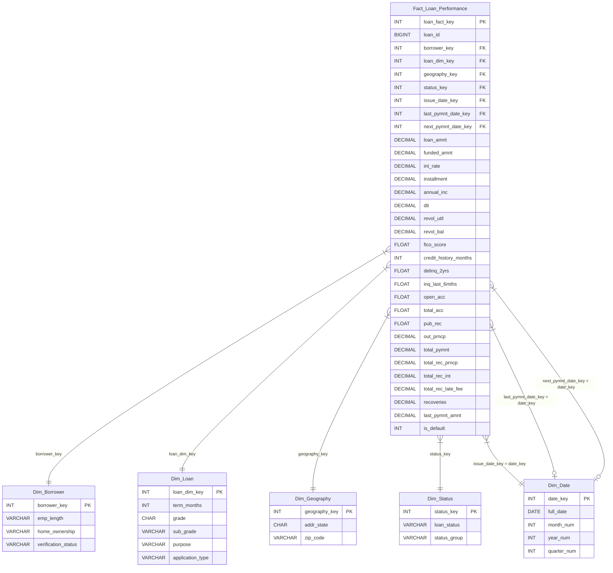

# Star Schema Design

The data warehouse used by the Power BI dashboards and the probability of default model.

- **Database:** `credit_risk_db`
- **Schema:** `warehouse`
- **Source:** `filtered.loans` (the cleaned data)
- **Grain:** one row per loan (`loan_id`)
- **Script:** `sql/04_star_schema.sql`

## Diagram

One fact table in the middle, linked to five dimension tables.

## Dimension Tables

Dimension tables hold the descriptive values used to filter and group the data. Each one has a key that SQL Server numbers automatically (`IDENTITY(1,1)`), except `Dim_Date`.

### `Dim_Borrower`
The borrower's details at application.
- **Key:** `borrower_key`
- **Columns:** `emp_length` (e.g. '10+ years', 'Unknown'), `home_ownership` (MORTGAGE, RENT, OWN, OTHER), `verification_status`

### `Dim_Loan`
The loan's terms and grade.
- **Key:** `loan_dim_key`
- **Columns:** `term_months` (36 or 60), `grade` (A-G), `sub_grade`, `purpose`, `application_type`

### `Dim_Geography`
Where the borrower lives.
- **Key:** `geography_key`
- **Columns:** `addr_state` (2-letter code), `zip_code` (first 3 digits only)

### `Dim_Date`
A calendar, one row per day from 2007-01-01 to 2019-12-31.
- **Key:** `date_key`, the date as a number (`YYYYMMDD`)
- **Columns:** `full_date`, `month_num`, `year_num`, `quarter_num`
- The fact table links to this table through three date keys. A missing date stays `NULL` in the fact table, so use `LEFT JOIN` on the optional dates or those loans will drop out of the results.

### `Dim_Status`
The loan's current status.
- **Key:** `status_key`
- **Columns:** `loan_status` (the original text), `status_group` (Active, Late, Paid, Defaulted)

## Fact Table

### `Fact_Loan_Performance`
One row per loan, with the numbers and the keys to each dimension.

**Keys:**
- `loan_fact_key`: primary key, numbered by SQL Server
- `loan_id`: the original LendingClub loan id. It has a `UNIQUE` constraint so a loan cannot be loaded twice
- `borrower_key`, `loan_dim_key`, `geography_key`, `status_key`, `issue_date_key`, `last_pymnt_date_key`, `next_pymnt_date_key`: links to the dimensions

**Loan amounts:** `loan_amnt`, `funded_amnt`, `int_rate`, `installment`

**Borrower risk at application** (used as model features): `annual_inc`, `dti`, `revol_util`, `revol_bal`, `fico_score`, `credit_history_months`, `delinq_2yrs`, `inq_last_6mths`, `open_acc`, `total_acc`, `pub_rec`

**Repayment so far:** `out_prncp`, `total_pymnt`, `total_rec_prncp`, `total_rec_int`, `total_rec_late_fee`, `recoveries`, `last_pymnt_amnt`. These are only known after the loan is issued, so they are used for monitoring, not as model features.

**Target:** `is_default` (1 = Charged Off or Default, 0 = Fully Paid, NULL = still open)
