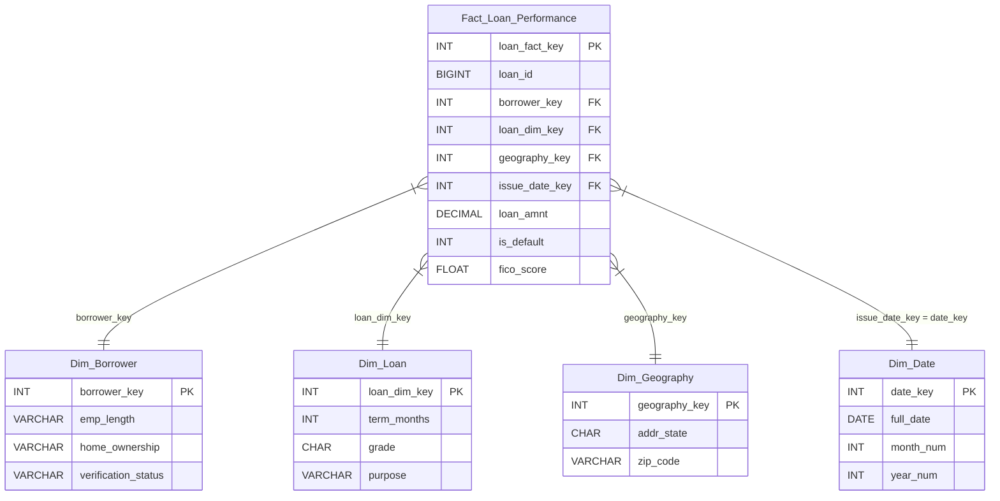

# Star Schema Design (Gold Layer)

This document explains the architecture of the final analytical data warehouse. This schema is designed to support both Power BI risk dashboards and the Phase 7 Machine Learning (Probability of Default) pipeline.

## 1. Architectural Overview

We use a standard dimensional model (Star Schema) consisting of one central Fact table surrounded by four Dimension tables.

* **Database:** `credit_risk_db`
* **Schema:** `warehouse`
* **Source Data:** Populated from `filtered.loans` (the cleaned Silver layer)
* **Grain:** 1 row = 1 unique loan origination (`loan_id`).

## 2. Entity-Relationship Diagram (ERD)

Below is the visual relationship of our Star Schema. The Fact table sits in the center, connected to the surrounding Dimension tables via one-to-many relationships.

## 3. Dimension Tables (The "Context")

Dimension tables hold descriptive, categorical attributes used to slice, filter, and group the numerical metrics. Each dimension uses an auto-incrementing surrogate key (`IDENTITY(1,1)`) to optimize join performance.

### `Dim_Borrower`
Captures the self-reported and verified characteristics of the person applying for the loan.
* **Surrogate Key:** `borrower_key`
* **Attributes:** `emp_length` (e.g., '10+ years', 'Unknown'), `home_ownership` (MORTGAGE, RENT, OWN, OTHER), `verification_status`.

### `Dim_Loan`
Captures the configuration, grading, and purpose of the loan product itself.
* **Surrogate Key:** `loan_dim_key`
* **Attributes:** `term_months` (36 or 60), `grade` (A-G), `sub_grade`, `purpose`, `application_type`.

### `Dim_Geography`
Captures the geographic location of the borrower at the time of origination.
* **Surrogate Key:** `geography_key`
* **Attributes:** `addr_state` (2-letter abbreviation), `zip_code` (3-digit masked).

### `Dim_Date`
A standard calendar lookup table for cohort and vintage analysis (time-series reporting).
* **Primary Key:** `date_key` (Format: `YYYYMMDD`)
* **Attributes:** `full_date`, `month_num`, `year_num`, `quarter_num`.

## 4. The Fact Table (The "Metrics")

### `Fact_Loan_Performance`
This is the massive central table holding all quantitative measurements, financial exposures, and the ultimate performance target.

**Keys:**
* **Primary Key:** `loan_fact_key` (Surrogate)
* **Natural Key:** `loan_id` (The original ID from Lending Club)
* **Foreign Keys:** `borrower_key`, `loan_dim_key`, `geography_key`, `issue_date_key`

**Core Financial Exposures (Metrics):**
* `loan_amnt`, `funded_amnt`, `int_rate`, `installment`

**Borrower Risk Metrics (Features for ML):**
* `annual_inc`, `dti`, `revol_util`, `revol_bal`, `fico_score`, `delinq_2yrs`, `inq_last_6mths`, `open_acc`, `total_acc`, `pub_rec`

**Repayment Tracking:**
* `out_prncp`, `total_pymnt`, `total_rec_prncp`, `total_rec_int`, `total_rec_late_fee`, `recoveries`, `last_pymnt_amnt`

**Target Variables:**
* `loan_status` (The raw text status)
* `is_default` (Binary: 1 = Bad/Charged Off, 0 = Good/Fully Paid, NULL = Active)